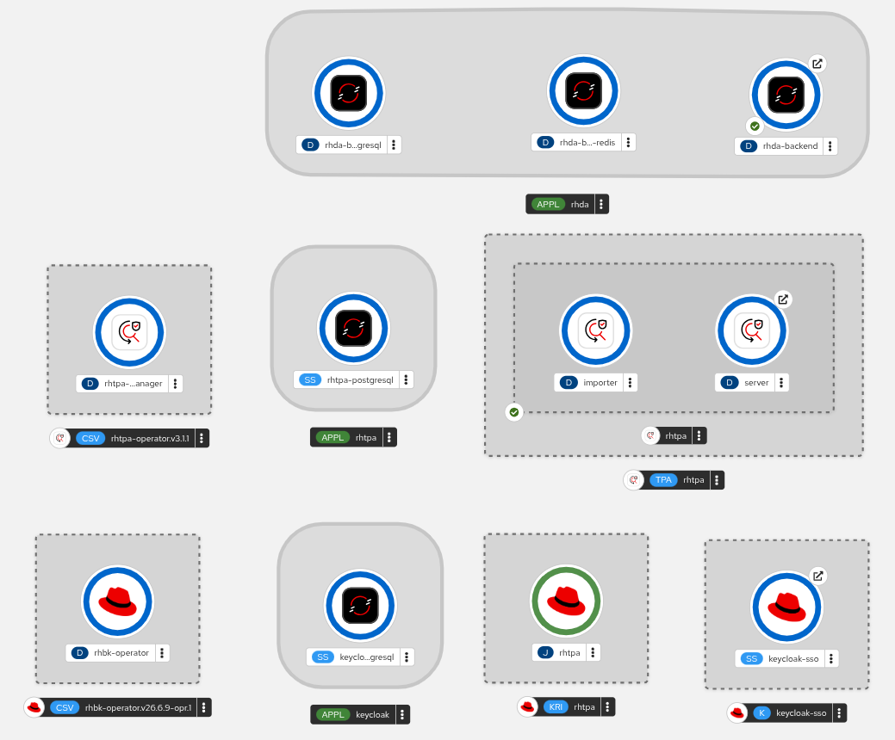

# Install on OpenShift Local

This guide installs Red Hat Trusted Profile Analyzer on OpenShift Local, from the virtual machine through removal.
Accounts, the topology, and shared troubleshooting are in [README.md](./README.md).

OpenShift Local is the laptop demo. `crc` runs OpenShift in a virtual machine. The apps domain is `apps-crc.testing`,
the overlay is `crc`, and the install command is `./deploy/deploy.sh crc`. The cluster-admin user is `kubeadmin`.
You also need a Red Hat account that can download OpenShift Local and a pull secret: [https://console.redhat.com/openshift/create/local](https://console.redhat.com/openshift/create/local).

Do these steps in order. From the root of this repository, `./deploy/deploy.sh crc` runs the stages below and
waits for each one. `./deploy/deploy-crc.sh` is the same command. The script stops before the RHTPA stage when
Secret `rhtpa-rhlw-creds` is missing. Create that Secret in the RHTPA stage, then run the script again.

```bash
./deploy/deploy.sh crc
```

Applying the RHTPA custom resource before the operator is installed, or before the ingress CA ConfigMap exists,
leaves the pods failing. `oc apply -k crc` reapplies the whole overlay once the operators exist. The first install
has to be staged, because the Keycloak and RHTPA custom resource definitions come from those operators.

The product's own baseline for RHTPA is 4 CPUs, 8 GiB of RAM, 45 GiB for the database, and 45 GiB for objects.
The manifests in `base` ask for less so the pods can schedule on this virtual machine next to Keycloak, and they
use smaller disks (10 GiB for RHTPA data, 10 GiB for the importer workspace, 10 GiB for the RHTPA database, 5 GiB
for the Keycloak database). Importers stay disabled until you turn one on. Documents stay on a filesystem volume.

Give the virtual machine room for OpenShift itself plus those pods:

- 12 CPUs
- 32 GiB of RAM
- 180 GiB of disk

```bash
crc config set cpus 12
crc config set memory 32768
crc config set disk-size 180
crc config view
```

## Start OpenShift Local

```bash
crc setup
crc start -p ~/pull-secret.txt
```

`crc start` downloads the bundle and boots the virtual machine. The first run often takes 15 to 30 minutes.
Leave it until the command prints the `kubeadmin` password and the console URL.

Put `oc` on your `PATH` and confirm the server version:

```bash
eval "$(crc oc-env)"
oc version
```

## Log in as cluster-admin

```bash
crc console --credentials
oc login -u kubeadmin https://api.crc.testing:6443
oc whoami
oc auth can-i '*' '*' --all-namespaces
```

`oc whoami` prints `kubeadmin`. The last command prints `yes`.

## Confirm the apps domain

```bash
oc get ingresscontroller.operator.openshift.io default \
  -n openshift-ingress-operator \
  -o jsonpath='{.status.domain}{"\n"}'
```

OpenShift Local prints `apps-crc.testing`. The `crc` overlay already contains that domain.

## Operators

```bash
oc apply -k base/00-operators
```

That creates the namespace `trusted-profile-analyzer`, one OperatorGroup, and two Subscriptions.

```bash
oc get csv -n trusted-profile-analyzer
```

When both operators are ready, the list looks like this:

```text
NAME                          DISPLAY                              VERSION        RELEASE   REPLACES                       PHASE
rhbk-operator.v26.6.9-opr.1   Red Hat build of Keycloak Operator   26.6.9-opr.1             rhbk-operator.v26.4.18-opr.1   Succeeded
rhtpa-operator.v3.1.1         Red Hat Trusted Profile Analyzer     3.1.1                    rhtpa-operator.v3.1.0          Succeeded
```

## PostgreSQL

```bash
oc apply -k base/10-database
oc wait --for=condition=Ready pod/rhtpa-postgresql-0 -n trusted-profile-analyzer --timeout=300s
oc wait --for=condition=Ready pod/keycloak-postgresql-0 -n trusted-profile-analyzer --timeout=300s
```

The pods use the default StorageClass. On OpenShift Local that class is created with the virtual machine. `oc get storageclass` must show one class marked `(default)`.

## Ingress CA

Keycloak is exposed with edge TLS, so the certificate browsers see is the cluster ingress certificate.
RHTPA has to trust that CA when it calls the issuer.

```bash
./deploy/import-router-ca.sh
oc get configmap ingress-ca -n trusted-profile-analyzer -o jsonpath='{.data.tls\.crt}' | head -n 2
```

The first line is `-----BEGIN CERTIFICATE-----`. The custom resource mounts this ConfigMap at `/etc/trust-anchor/tls.crt`.

## Keycloak

```bash
oc apply -k crc/20-keycloak
oc wait --for=condition=Ready keycloak/keycloak-sso -n trusted-profile-analyzer --timeout=900s
```

The Keycloak custom resource is named `keycloak-sso`. The first start optimizes the Keycloak image and
then runs the server. On a laptop this is often 5 to 10 minutes.

```bash
oc get keycloak keycloak-sso -n trusted-profile-analyzer
oc get pods -n trusted-profile-analyzer -l app=keycloak
```

`Ready` is `True` when the instance can serve requests. The route host is `sso-trusted-profile-analyzer.apps-crc.testing`.

## Realm, client, and users

```bash
oc apply -k crc/30-realm
oc wait --for=condition=Done keycloakrealmimport/rhtpa -n trusted-profile-analyzer --timeout=900s
```

The import runs once. Applying the file again does not change a realm that already exists.
Passwords and the `cli` client secret are placeholders (`${RHTPA_ADMIN_PASSWORD}` and so on) filled from
the Secrets in the PostgreSQL stage.

The realm contains:

- realm `trustify`
- public client `frontend` for the console, with redirect URIs for `https://server-trusted-profile-analyzer.apps-crc.testing/*` and for `http://localhost:8080/*`
- confidential client `cli` for the API, service accounts enabled, secret taken from Secret `oidc-cli`
- user `admin` with roles `trustify-admin`, `trustify-manager`, and `trustify-user`
- user `analyst` with role `trustify-user`

`frontend` has `directAccessGrantsEnabled: false`. The console uses the authorization code flow.

## Red Hat Trusted Profile Analyzer Instance

### Secrets

The custom resource declares two Lightwell HTTP importers. Both stay disabled until you turn one on.

| Importer | Repository |
|---|---|
| `redhat-lightwell-osv-java` | `https://packages.redhat.com/lightwell/osv/java/remediated/` |
| `redhat-lightwell-osv-python` | `https://packages.redhat.com/lightwell/osv/python/remediated/` |

Those repositories require HTTP basic authentication. The username and the token identify your Lightwell account.

```bash
export LW_USERNAME=<your-user-name>
export LW_PASSWORD=<your-user-token>
```

The custom resource mounts that Secret at `/run/secrets/rhtpa-rhlw-creds`. Each key becomes a file.
Both importers read the username from `rhlw.user` and the token from `rhlw.token`.

Create Secret `rhtpa-rhlw-creds` yourself in the `trusted-profile-analyzer` namespace.
The namespace exists after the Operators stage.

```bash
oc create secret generic rhtpa-rhlw-creds \
  -n trusted-profile-analyzer \
  --from-literal=RH_LW_USERNAME="$LW_USERNAME" \
  --from-literal=RH_LW_PASSWORD="$LW_PASSWORD"
```

The keys must be exactly `rhlw.user` and `rhlw.token`. To change them later, delete the Secret, and
create it again with the same command and the new values:

```bash
oc delete secret rhtpa-rhlw-creds -n trusted-profile-analyzer
oc create secret generic rhtpa-rhlw-creds \
  -n trusted-profile-analyzer \
  --from-literal=RH_LW_USERNAME="$LW_USERNAME" \
  --from-literal=RH_LW_PASSWORD="$LW_PASSWORD"
```

Deploy TPA:

```bash
oc apply -k crc/40-rhtpa
```

The operator creates a `create-db` job, a `migrate-db` job, then Deployments named `server` and `importer`.
The jobs delete themselves about ten minutes after they succeed.

```bash
oc wait --for=condition=Available deployment/server -n trusted-profile-analyzer --timeout=900s
oc wait --for=condition=Available deployment/importer -n trusted-profile-analyzer --timeout=900s
oc get pods,jobs,routes -n trusted-profile-analyzer
```

The route host is `server-trusted-profile-analyzer.apps-crc.testing`.
Documents are stored on the filesystem volume from `crc/40-rhtpa`.

## Sign in

1. Trust the OpenShift ingress CA in your browser if it warns you.
2. Open `https://server-trusted-profile-analyzer.apps-crc.testing`.
3. Sign in as `admin` / `admin123456`.
4. Sign out and sign in as `analyst` / `analyst123456`.

The console is empty of advisories until you upload an SBOM or enable an importer. An empty console with a successful login means the install worked. An upload as `analyst` is rejected. The same upload as `admin` is accepted.

## Red Hat Dependency Analytics

[Red Hat Dependency Analytics](https://marketplace.visualstudio.com/items?itemName=redhat.fabric8-analytics) is the IDE extension that inspects an application's dependencies.
From a software bill of materials it reports known vulnerabilities, license information, and remediation
suggestions. By default the extension calls Red Hat's hosted backend at `https://rhda.rhcloud.com`.
This repository runs that same backend in the cluster and points it at the RHTPA instance installed above.

This is the namespace after that stage. The group at the top is Dependency Analytics.
The other objects are the RHTPA and Keycloak install from the earlier chapters.



| Piece | Role |
|---|---|
| `rhda-backend` | Receives an SBOM from the IDE, asks RHTPA about those packages, and returns the report |
| `rhda-backend-postgresql` | Database for the backend. Password `rhda-lab-pass` in Secret `rhda-backend-postgresql` |
| `rhda-backend-redis` | Cache for vulnerability and license results |
| Keycloak client `cli` | Client-credentials grant. The secret is the existing Secret `oidc-cli` |
| RHTPA `server` service | `https://server.trusted-profile-analyzer.svc:443` |

### Install

```bash
./deploy/deploy-rhda.sh crc
```

The script stops when Keycloak `keycloak-sso`, RHTPA `deployment/server`, Secret `oidc-cli`,
or ConfigMap `ingress-ca` is missing. To apply the stage yourself:

```bash
oc apply -k crc/50-rhda
oc start-build bc/rhda-backend -n trusted-profile-analyzer --follow
oc wait --for=condition=Available deployment/rhda-backend-postgresql -n trusted-profile-analyzer --timeout=300s
oc wait --for=condition=Available deployment/rhda-backend-redis -n trusted-profile-analyzer --timeout=300s
oc wait --for=condition=Available deployment/rhda-backend -n trusted-profile-analyzer --timeout=900s
oc get route rhda-backend -n trusted-profile-analyzer -o jsonpath='https://{.spec.host}{"\n"}'
```

The route host is `rhda-backend-trusted-profile-analyzer.apps-crc.testing`.

The backend trusts two CAs. `rhda-service-ca` is the OpenShift service CA, used for the RHTPA service certificate.
`ingress-ca` is the router CA from `./deploy/import-router-ca.sh`, used when the backend calls the Keycloak route for a token.

### Point the IDE at this backend

In VS Code, set **Red Hat Dependency Analytics: Backend URL** to the route printed above,
or add it to the workspace `.vscode/settings.json`:

```json
{
  "redHatDependencyAnalytics.backendUrl": "https://rhda-backend-trusted-profile-analyzer.apps-crc.testing"
}
```

The extension id is `redhat.fabric8-analytics`. Reports link back to this RHTPA console at `/search`.

### Remove only this component

```bash
oc delete -k crc/50-rhda
```

That removes the RHDA backend, its database, and its cache. Keycloak and RHTPA stay in place.

## Remove it

```bash
oc delete -k crc
```

Stop the laptop cluster with `crc stop`. `crc delete` removes the virtual machine and every namespace in it.

Deleting the namespace removes Keycloak, RHTPA, both databases, and the PVCs. Custom resource definitions
installed by the operators stay on the cluster so a later install does not have to reinstall them.
Delete those definitions only when nothing else on the cluster uses Keycloak or RHTPA:

```bash
oc delete crd trustedprofileanalyzers.rhtpa.io \
  keycloaks.k8s.keycloak.org \
  keycloakrealmimports.k8s.keycloak.org
```

Importer failures that show up after sign-in are described in [Troubleshooting](./README.md#troubleshooting).
