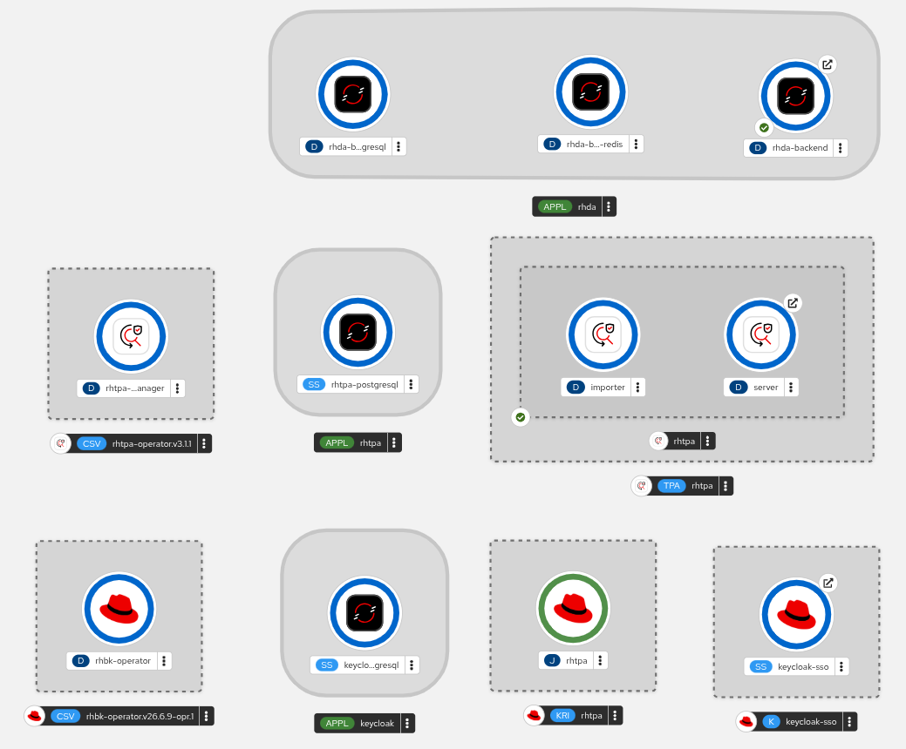

# Install on OpenShift

This guide installs Red Hat Trusted Profile Analyzer on a standard OpenShift cluster,
from requesting the cluster through removal. Accounts, the topology,
and shared troubleshooting are in [README.md](./README.md).

The stages match the OpenShift Local install, with one extra phase for object storage. Operators, PostgreSQL,
and the ingress CA come from `base` and `deploy/import-router-ca.sh`. Keycloak, the realm, the object bucket,
and RHTPA come from the `ocp` overlay after the script fills in the apps domain and the bucket name.

OpenShift Local stores documents on the filesystem volume in `crc/40-rhtpa`. This guide stores them in
an S3 bucket created by OpenShift Data Foundation.

From the root of this repository, `./deploy/deploy.sh ocp` runs every stage and waits for each one.
`./deploy/deploy-ocp.sh` is the same command. Create Secret `rhtpa-rhlw-creds` before the RHTPA stage,
then run the script again if it stopped there.

```bash
./deploy/deploy.sh ocp
```

## Get a cluster

This repository does not install the cluster. You need the API address of a cluster that is already running,
and a `kubeconfig` that can reach it.

One place to request that cluster is the Red Hat Demo Platform. In the catalog, choose **OpenShift Container Platform Cluster (Multi-Cloud)**:

[OpenShift Container Platform Cluster (Multi-Cloud)](https://catalog.demo.redhat.com/catalog/all?search=OpenShift+Container+Platform+Cluster+%28Multi-Cloud%29&item=babylon-catalog-prod%2Fpublished.ocp4-cluster.prod)

The cluster needs a default StorageClass for PostgreSQL, and OpenShift Data Foundation so RHTPA can store
documents in an object bucket. The same smaller resource requests from `base` are used here as on OpenShift Local.

```bash
oc version
```

The server line is the cluster you will install into. Confirm a default StorageClass exists before
the PostgreSQL stage, and confirm the NooBaa class from OpenShift Data Foundation exists before the object-storage phase:

```bash
oc get storageclass
```

One class is marked `(default)`. The list also includes `openshift-storage.noobaa.io`.

## Log in as cluster-admin

```bash
oc login <api-url>
oc whoami
oc auth can-i '*' '*' --all-namespaces
```

`oc whoami` prints your user. The last command prints `yes`.

## Confirm the apps domain

Read the domain the cluster uses for application routes:

```bash
oc get ingresscontroller.operator.openshift.io default \
  -n openshift-ingress-operator \
  -o jsonpath='{.status.domain}{"\n"}'
```

`./deploy/deploy.sh ocp` runs that command and writes the value into a temporary copy of the `ocp` overlay,
in place of `__INGRESS_DOMAIN__`, before it applies anything. The files in git keep the token.
The script updates these hostnames:

| File | What receives the domain |
|---|---|
| `ocp/20-keycloak/hostname.yaml` | Keycloak route `sso-trusted-profile-analyzer.<domain>` |
| `ocp/30-realm/realm-urls.yaml` | Console redirect URIs `https://server-trusted-profile-analyzer.<domain>/*` |
| `ocp/40-rhtpa/domain.yaml` | `appDomain`, the OIDC issuer `https://sso-trusted-profile-analyzer.<domain>/realms/trustify`, and the S3 endpoint `https://s3-openshift-storage.<domain>:443` |

The resulting hosts are `server-trusted-profile-analyzer.<domain>` and `sso-trusted-profile-analyzer.<domain>`.
Apply the overlay with the script so those names are filled in. `oc delete -k ocp` still matches the objects,
because their names do not include the domain.

## Operators

```bash
oc apply -k base/00-operators
```

That creates the namespace `trusted-profile-analyzer`, one OperatorGroup, and two Subscriptions.

```bash
oc get csv -n trusted-profile-analyzer
```

Wait until `rhbk-operator` and `rhtpa-operator` both show `Succeeded`.

## PostgreSQL

```bash
oc apply -k base/10-database
oc wait --for=condition=Ready pod/rhtpa-postgresql-0 -n trusted-profile-analyzer --timeout=300s
oc wait --for=condition=Ready pod/keycloak-postgresql-0 -n trusted-profile-analyzer --timeout=300s
```

The pods use the default StorageClass from the previous section.

## Ingress CA

Keycloak is exposed with edge TLS, so the certificate browsers see is the cluster ingress certificate.
RHTPA has to trust that CA when it calls the issuer.

```bash
./deploy/import-router-ca.sh
oc get configmap ingress-ca -n trusted-profile-analyzer -o jsonpath='{.data.tls\.crt}' | head -n 2
```

The first line is `-----BEGIN CERTIFICATE-----`. The custom resource mounts this ConfigMap at `/etc/trust-anchor/tls.crt`.

## Keycloak

`./deploy/deploy.sh ocp` applies the rendered `ocp/20-keycloak` overlay, with your apps domain already
written into the hostname. Then wait for the instance:

```bash
oc wait --for=condition=Ready keycloak/keycloak-sso -n trusted-profile-analyzer --timeout=900s
oc get keycloak keycloak-sso -n trusted-profile-analyzer
oc get pods -n trusted-profile-analyzer -l app=keycloak
```

The Keycloak custom resource is named `keycloak-sso`. The first start optimizes the Keycloak image and
then runs the server. `Ready` is `True` when the instance can serve requests. The route host is `sso-trusted-profile-analyzer.<domain>`.

## Realm, client, and users

The same script applies the rendered `ocp/30-realm` overlay. The console redirect URIs use `https://server-trusted-profile-analyzer.<domain>/*` and `http://localhost:8080/*`.

```bash
oc wait --for=condition=Done keycloakrealmimport/rhtpa -n trusted-profile-analyzer --timeout=900s
```

The import runs once. Applying the file again does not change a realm that already exists.
Passwords and the `cli` client secret are placeholders (`${RHTPA_ADMIN_PASSWORD}` and so on) filled from
the Secrets in the PostgreSQL stage.

The realm contains:

- realm `trustify`
- public client `frontend` for the console
- confidential client `cli` for the API, service accounts enabled, secret taken from Secret `oidc-cli`
- user `admin` with roles `trustify-admin`, `trustify-manager`, and `trustify-user`
- user `analyst` with role `trustify-user`

`frontend` has `directAccessGrantsEnabled: false`. The console uses the authorization code flow.

## Object storage

OpenShift Data Foundation is already installed on the cluster. `./deploy/deploy.sh ocp` applies
`ocp/35-storage` before the RHTPA custom resource. That phase creates one ObjectBucketClaim, `tpa-bucket-claim`,
on storage class `openshift-storage.noobaa.io`. The claim asks NooBaa to generate a bucket whose name starts with `trustify`.

When the claim is bound, OpenShift Data Foundation creates a ConfigMap and a Secret, both named
`tpa-bucket-claim`, in `trusted-profile-analyzer`. The ConfigMap key `BUCKET_NAME` is the generated bucket.
The Secret keys `AWS_ACCESS_KEY_ID` and `AWS_SECRET_ACCESS_KEY` are the credentials.

The script waits until both values exist, then writes `BUCKET_NAME` into `storage.bucket` in the rendered
copy of `ocp/40-rhtpa/domain.yaml`. The file in git keeps the token `__BUCKET_NAME__`. The access keys stay
references to Secret `tpa-bucket-claim`, and the S3 endpoint stays the NooBaa route for this cluster.

```bash
oc get objectbucketclaim tpa-bucket-claim -n trusted-profile-analyzer
oc get configmap tpa-bucket-claim -n trusted-profile-analyzer -o jsonpath='{.data.BUCKET_NAME}{"\n"}'
```

The command prints the bucket name, for example `trustify-15e1520c-fcd6-469b-a07e-dcb2d2359c90`.

## Red Hat Trusted Profile Analyzer Instance

### Secrets

The custom resource declares two Lightwell HTTP importers. Both stay disabled until you turn one on.

| Importer | Repository |
|---|---|
| `redhat-lightwell-osv-java` | `https://packages.redhat.com/lightwell/osv/java/remediated/` |
| `redhat-lightwell-osv-python` | `https://packages.redhat.com/lightwell/osv/python/remediated/` |

Those repositories require HTTP basic authentication. The username and the token identify your Lightwell account.

```bash
export LW_USERNAME=<your-user-name>
export LW_PASSWORD=<your-user-token>
oc create secret generic rhtpa-rhlw-creds \
  -n trusted-profile-analyzer \
  --from-literal=RH_LW_USERNAME="$LW_USERNAME" \
  --from-literal=RH_LW_PASSWORD="$LW_PASSWORD"
```

The namespace exists after the Operators stage. The custom resource mounts that Secret at `/run/secrets/rhtpa-rhlw-creds`.
Each key becomes a file. Both importers read the username from `rhlw.user` and the token from `rhlw.token`.
The keys must be exactly those names.

To change them later, delete the Secret, and create it again with the same command and the new values:

```bash
oc delete secret rhtpa-rhlw-creds -n trusted-profile-analyzer
oc create secret generic rhtpa-rhlw-creds \
  -n trusted-profile-analyzer \
  --from-literal=RH_LW_USERNAME="$LW_USERNAME" \
  --from-literal=RH_LW_PASSWORD="$LW_PASSWORD"
```

`./deploy/deploy.sh ocp` applies the rendered `ocp/40-rhtpa` overlay after phase 35-storage.
`appDomain`, the issuer URL, and `storage.bucket` are already filled in. `storage.type` is `s3`.

```bash
oc wait --for=condition=Available deployment/server -n trusted-profile-analyzer --timeout=900s
oc wait --for=condition=Available deployment/importer -n trusted-profile-analyzer --timeout=900s
oc get pods,jobs,routes -n trusted-profile-analyzer
oc get route server -n trusted-profile-analyzer -o jsonpath='https://{.spec.host}{"\n"}'
```

The operator creates a `create-db` job, a `migrate-db` job, then Deployments named `server` and `importer`.
The jobs delete themselves about ten minutes after they succeed. The route host is `server-trusted-profile-analyzer.<domain>`.

## Sign in

1. Trust the OpenShift ingress CA in your browser if it warns you.
2. Open the RHTPA console URL printed by the deploy script, `https://server-trusted-profile-analyzer.<domain>`.
3. Sign in as `admin` / `admin123456`.
4. Sign out and sign in as `analyst` / `analyst123456`.

The console is empty of advisories until you upload an SBOM or enable an importer. An empty console with a
successful login means the install worked. An upload as `analyst` is rejected.
The same upload as `admin` is accepted.

## Red Hat Dependency Analytics

[Red Hat Dependency Analytics](https://marketplace.visualstudio.com/items?itemName=redhat.fabric8-analytics) is the IDE extension that inspects an application's dependencies.
From a software bill of materials it reports known vulnerabilities, license information, and remediation
suggestions. By default the extension calls Red Hat's hosted backend at `https://rhda.rhcloud.com`.
This repository runs that same backend in the cluster and points it at the RHTPA instance installed above.

This is the namespace after that stage. The group at the top is Dependency Analytics. The other objects are
the RHTPA and Keycloak install from the earlier chapters.



| Piece | Role |
|---|---|
| `rhda-backend` | Receives an SBOM from the IDE, asks RHTPA about those packages, and returns the report |
| `rhda-backend-postgresql` | Database for the backend. Password `rhda-lab-pass` in Secret `rhda-backend-postgresql` |
| `rhda-backend-redis` | Cache for vulnerability and license results |
| Keycloak client `cli` | Client-credentials grant. The secret is the existing Secret `oidc-cli` |
| RHTPA `server` service | `https://server.trusted-profile-analyzer.svc:443` |

### Install

```bash
./deploy/deploy-rhda.sh ocp
```

The script reads the ingress domain and writes it into a temporary copy of `ocp/50-rhda` before apply.
The files in git keep `__INGRESS_DOMAIN__`. It stops when Keycloak `keycloak-sso`, RHTPA `deployment/server`,
Secret `oidc-cli`, or ConfigMap `ingress-ca` is missing.

The route host is `rhda-backend-trusted-profile-analyzer.<domain>`. The script prints the URL.

The backend trusts two CAs. `rhda-service-ca` is the OpenShift service CA, used for the RHTPA service certificate.
`ingress-ca` is the router CA from `./deploy/import-router-ca.sh`, used when the backend calls the Keycloak route for a token.

### Point the IDE at this backend

In VS Code, set **Red Hat Dependency Analytics: Backend URL** to the route printed above, or add it to the
workspace `.vscode/settings.json`. Replace `apps-crc.testing` with this cluster's ingress domain:

```json
{
  "redhat.dependency.analytics.exhort.backendUrl": "https://rhda-backend-trusted-profile-analyzer.<domain>"
}
```

The extension id is `redhat.fabric8-analytics`. Reports link back to this RHTPA console at `/search`.

### Remove only this component

```bash
oc delete -k ocp/50-rhda
```

That removes the RHDA backend, its database, and its cache. Keycloak and RHTPA stay in place.
`oc delete -k ocp/50-rhda` uses the files in git, which still contain `__INGRESS_DOMAIN__`.
The object names do not include the domain, so the delete still matches.

## Remove it

```bash
oc delete -k ocp
```

`oc delete -k ocp` matches the objects on the cluster. The apps domain is not part of their names.
Deleting the overlay also deletes ObjectBucketClaim `tpa-bucket-claim`, which removes the generated bucket.

Deleting the namespace removes Keycloak, RHTPA, both databases, and the PVCs. Custom resource definitions
installed by the operators stay on the cluster so a later install does not have to reinstall them.
Delete those definitions only when nothing else on the cluster uses Keycloak or RHTPA:

```bash
oc delete crd trustedprofileanalyzers.rhtpa.io \
  keycloaks.k8s.keycloak.org \
  keycloakrealmimports.k8s.keycloak.org
```

Importer failures that show up after sign-in are described in [Troubleshooting](./README.md#troubleshooting).
