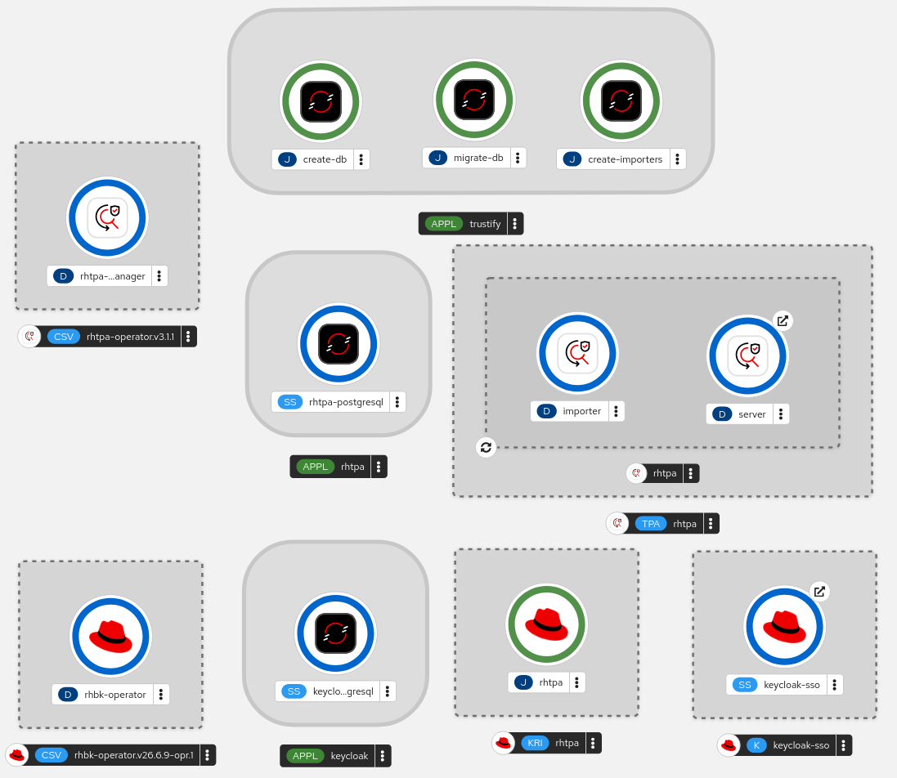
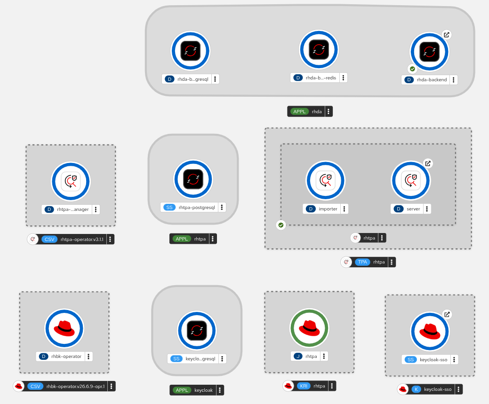

# Demo of Red Hat Trusted Profile Analyzer on OpenShift (Local)

This repository installs **Red Hat Trusted Profile Analyzer (RHTPA)** on **OpenShift** with Kustomize.

Manifests that are the same on every OpenShift cluster live in `base`. Two overlays extend that base:

| Overlay | Cluster | What it changes |
|---|---|---|
| `crc` | OpenShift Local | Hostnames under `apps-crc.testing` |
| `ocp` | A standard OpenShift cluster | The same hostnames, using that cluster's ingress domain |

The components installed are:

- the **Red Hat build of Keycloak (RHBK)** operator
- one Keycloak server, custom resource name `keycloak-sso`
- a realm named `trustify`, the public client `frontend`, the confidential client `cli`, and two users
- the **Red Hat Trusted Profile Analyzer** operator
- one **TrustedProfileAnalyzer** custom resource
- PostgreSQL databases for Keycloak and RHTPA

Keycloak is its own application. The custom resource is `keycloak-sso`, and its labels use `app.kubernetes.io/part-of: keycloak`. RHTPA consumes the `trustify` realm.

## What you can open when it finishes

This is a diagram of the final deployment:



On OpenShift Local the hosts are:

| | |
|---|---|
| RHTPA console | `https://server-trusted-profile-analyzer.apps-crc.testing` |
| Keycloak account login | `https://sso-trusted-profile-analyzer.apps-crc.testing` |
| Keycloak master admin | `https://sso-trusted-profile-analyzer.apps-crc.testing/admin` |
| Keycloak TPA realm | `https://sso-trusted-profile-analyzer.apps-crc.testing/realms/trustify` |

On a standard OpenShift cluster the same four hosts use that cluster's apps domain in place of `apps-crc.testing`. The deploy script prints the URLs when the install finishes.

## Lab accounts

These values are written in `base/10-database/secrets.yaml` and in the realm import.
Change them before the routes are reachable by anyone else.

| Who | Username | Password | What they can do |
|---|---|---|---|
| RHTPA administrator | `admin` | `admin123456` | Read, upload, update, and delete documents. Realm roles `trustify-admin` and `trustify-manager`. |
| RHTPA reader | `analyst` | `analyst123456` | Read. Realm role `trustify-user`. |
| Keycloak master administrator | `admin` | `admin123456` | The `/admin` console. This is a different account from the RHTPA `admin` user: same password, different realm (`master`). |
| CLI client | client id `cli` | secret `5460cc91-4e20-4edd-881c-b15b169f8a79` | Service account for API calls. Same lab secret as the RHTPA 3.1 deployment guide. |

Database passwords, if you need them while debugging:

| Database | User | Password | Service |
|---|---|---|---|
| `trustify` | `trustify` | `trustify-lab-pass` | `rhtpa-postgresql:5432` |
| maintenance | `postgres` | `postgres-lab-pass` | `rhtpa-postgresql:5432` |
| `keycloak` | `keycloak` | `keycloak-lab-pass` | `keycloak-postgresql:5432` |

### Why the two users are different

- `trustify-user` (analyst) maps to read permissions.
- `trustify-manager` and `trustify-admin` (admin) map to read and write permissions.

## What you need

Both environments use the same `base` manifests, the `oc` client, and `python3`. The deploy script uses `python3` to read the operator catalog. The account you use must be **cluster-admin**, and the cluster pull secret must be allowed to pull images from `registry.redhat.io`.

Choose the environment that matches the cluster you have, then follow that install chapter. The scripts refuse the other cluster: `./deploy/deploy.sh crc` requires the apps domain `apps-crc.testing`, and `./deploy/deploy.sh ocp` requires any other apps domain.

**OpenShift Local** is the laptop demo. `crc` runs OpenShift in a virtual machine. The apps domain is `apps-crc.testing`, the overlay is `crc`, and the install command is `./deploy/deploy.sh crc`. The cluster-admin user is `kubeadmin`. You also need a Red Hat account that can download OpenShift Local and a pull secret: [https://console.redhat.com/openshift/create/local](https://console.redhat.com/openshift/create/local).

The product's own baseline for RHTPA is 4 CPUs, 8 GiB of RAM, 45 GiB for the database, and 45 GiB for objects. The manifests in `base` ask for less so the pods can schedule on this virtual machine next to Keycloak, and they use smaller disks (10 GiB for RHTPA data, 10 GiB for the importer workspace, 10 GiB for the RHTPA database, 5 GiB for the Keycloak database). Importers stay disabled until you turn one on.

Give the virtual machine room for OpenShift itself plus those pods:

- 12 CPUs
- 32 GiB of RAM
- 180 GiB of disk

```bash
crc config set cpus 12
crc config set memory 32768
crc config set disk-size 180
crc config view
```

**A standard OpenShift cluster** is a cluster you already administer. This repository does not install that cluster. The overlay is `ocp`, and the install command is `./deploy/deploy.sh ocp`. The script reads the cluster ingress domain and writes it into the hostnames before it applies the overlay. The cluster needs a default StorageClass. The same smaller resource requests from `base` are used here as on OpenShift Local.

## Install on OpenShift Local

Do these steps in order. From the root of this repository, `./deploy/deploy.sh crc` runs the stages below and waits for each one. `./deploy/deploy-crc.sh` is the same command. The script stops before the RHTPA stage when Secret `rhtpa-rhlw-creds` is missing. Create that Secret in the RHTPA stage, then run the script again.

Applying the RHTPA custom resource before the operator is installed, or before the ingress CA ConfigMap exists, leaves the pods failing. `oc apply -k crc` reapplies the whole overlay once the operators exist. The first install has to be staged, because the Keycloak and RHTPA custom resource definitions come from those operators.

### Start OpenShift Local

```bash
crc setup
crc start -p ~/pull-secret.txt
```

`crc start` downloads the bundle and boots the virtual machine. The first run often takes 15 to 30 minutes. Leave it until the command prints the `kubeadmin` password and the console URL.

Put `oc` on your `PATH` and confirm the server version:

```bash
eval "$(crc oc-env)"
oc version
```

### Log in as cluster-admin

```bash
crc console --credentials
oc login -u kubeadmin https://api.crc.testing:6443
oc whoami
oc auth can-i '*' '*' --all-namespaces
```

`oc whoami` prints `kubeadmin`. The last command prints `yes`.

### Confirm the apps domain

```bash
oc get ingresscontroller.operator.openshift.io default \
  -n openshift-ingress-operator \
  -o jsonpath='{.status.domain}{"\n"}'
```

OpenShift Local prints `apps-crc.testing`. The `crc` overlay already contains that domain. A different value means this cluster is a standard OpenShift cluster: continue with [Install on OpenShift](#install-on-openshift).

### Operators

```bash
oc apply -k base/00-operators
```

That creates the namespace `trusted-profile-analyzer`, one OperatorGroup, and two Subscriptions.

```bash
oc get csv -n trusted-profile-analyzer
```

When both operators are ready, the list looks like this:

```text
NAME                          DISPLAY                              VERSION        RELEASE   REPLACES                       PHASE
rhbk-operator.v26.6.9-opr.1   Red Hat build of Keycloak Operator   26.6.9-opr.1             rhbk-operator.v26.4.18-opr.1   Succeeded
rhtpa-operator.v3.1.1         Red Hat Trusted Profile Analyzer     3.1.1                    rhtpa-operator.v3.1.0          Succeeded
```

### PostgreSQL

```bash
oc apply -k base/10-database
oc wait --for=condition=Ready pod/rhtpa-postgresql-0 -n trusted-profile-analyzer --timeout=300s
oc wait --for=condition=Ready pod/keycloak-postgresql-0 -n trusted-profile-analyzer --timeout=300s
```

The pods use the default StorageClass. On OpenShift Local that class is created with the virtual machine. `oc get storageclass` must show one class marked `(default)`.

### Ingress CA

Keycloak is exposed with edge TLS, so the certificate browsers see is the cluster ingress certificate. RHTPA has to trust that CA when it calls the issuer.

```bash
./deploy/import-router-ca.sh
oc get configmap ingress-ca -n trusted-profile-analyzer -o jsonpath='{.data.tls\.crt}' | head -n 2
```

The first line is `-----BEGIN CERTIFICATE-----`. The custom resource mounts this ConfigMap at `/etc/trust-anchor/tls.crt`.

### Keycloak

```bash
oc apply -k crc/20-keycloak
oc wait --for=condition=Ready keycloak/keycloak-sso -n trusted-profile-analyzer --timeout=900s
```

The Keycloak custom resource is named `keycloak-sso`. The first start optimizes the Keycloak image and then runs the server. On a laptop this is often 5 to 10 minutes.

```bash
oc get keycloak keycloak-sso -n trusted-profile-analyzer
oc get pods -n trusted-profile-analyzer -l app=keycloak
```

`Ready` is `True` when the instance can serve requests. The route host is `sso-trusted-profile-analyzer.apps-crc.testing`.

### Realm, client, and users

```bash
oc apply -k crc/30-realm
oc wait --for=condition=Done keycloakrealmimport/rhtpa -n trusted-profile-analyzer --timeout=900s
```

The import runs once. Applying the file again does not change a realm that already exists. Passwords and the `cli` client secret are placeholders (`${RHTPA_ADMIN_PASSWORD}` and so on) filled from the Secrets in the PostgreSQL stage.

The realm contains:

- realm `trustify`
- public client `frontend` for the console, with redirect URIs for `https://server-trusted-profile-analyzer.apps-crc.testing/*` and for `http://localhost:8080/*`
- confidential client `cli` for the API, service accounts enabled, secret taken from Secret `oidc-cli`
- user `admin` with roles `trustify-admin`, `trustify-manager`, and `trustify-user`
- user `analyst` with role `trustify-user`

`frontend` has `directAccessGrantsEnabled: false`. The console uses the authorization code flow.

### Red Hat Trusted Profile Analyzer Instance

#### Secrets

The custom resource declares two Lightwell HTTP importers. Both stay disabled until you turn one on.

| Importer | Repository |
|---|---|
| `redhat-lightwell-osv-java` | `https://packages.redhat.com/lightwell/osv/java/remediated/` |
| `redhat-lightwell-osv-python` | `https://packages.redhat.com/lightwell/osv/python/remediated/` |

Those repositories require HTTP basic authentication. The username and the token identify your Lightwell account.

```bash
export LW_USERNAME=<your-user-name>
export LW_PASSWORD=<your-user-token>
```

The custom resource mounts that Secret at `/run/secrets/rhtpa-rhlw-creds`. Each key becomes a file. Both importers read the username from `rhlw.user` and the token from `rhlw.token`.

Create Secret `rhtpa-rhlw-creds` yourself in the `trusted-profile-analyzer` namespace. The namespace exists after the Operators stage.

```bash
oc create secret generic rhtpa-rhlw-creds \
  -n trusted-profile-analyzer \
  --from-literal=RH_LW_USERNAME="$LW_USERNAME" \
  --from-literal=RH_LW_PASSWORD="$LW_PASSWORD"
```

The keys must be exactly `rhlw.user` and `rhlw.token`. To change them later, delete the Secret, create it again with the same command and the new values, then restart the importer:

```bash
oc delete secret rhtpa-rhlw-creds -n trusted-profile-analyzer
oc create secret generic rhtpa-rhlw-creds \
  -n trusted-profile-analyzer \
  --from-literal=RH_LW_USERNAME="$LW_USERNAME" \
  --from-literal=RH_LW_PASSWORD="$LW_PASSWORD"
oc rollout restart deployment/importer -n trusted-profile-analyzer
```

```bash
oc apply -k crc/40-rhtpa
```

The operator creates a `create-db` job, a `migrate-db` job, then Deployments named `server` and `importer`. The jobs delete themselves about ten minutes after they succeed.

```bash
oc wait --for=condition=Available deployment/server -n trusted-profile-analyzer --timeout=900s
oc wait --for=condition=Available deployment/importer -n trusted-profile-analyzer --timeout=900s
oc get pods,jobs,routes -n trusted-profile-analyzer
oc get route server -n trusted-profile-analyzer -o jsonpath='https://{.spec.host}{"\n"}'
```

The route host is `server-trusted-profile-analyzer.apps-crc.testing`.

## Install on OpenShift

Use this chapter for a standard OpenShift cluster. The stages match the OpenShift Local install. Operators,
PostgreSQL, and the ingress CA come from `base` and `deploy/import-router-ca.sh`. Keycloak, the realm,
and RHTPA come from the `ocp` overlay after the script fills in the apps domain.

From the root of this repository, `./deploy/deploy.sh ocp` runs every stage and waits for each one.
`./deploy/deploy-ocp.sh` is the same command. Create Secret `rhtpa-rhlw-creds` before the RHTPA stage,
then run the script again if it stopped there.

### Start OpenShift

A standard OpenShift cluster is already installed. This repository deploys Keycloak and RHTPA onto it.
You need the API address of that cluster and a kubeconfig that can reach it.

```bash
oc version
```

The server line is the cluster you will install into. Confirm a default StorageClass exists before
the PostgreSQL stage:

```bash
oc get storageclass
```

One class is marked `(default)`.

### Log in as cluster-admin

```bash
oc login <api-url>
oc whoami
oc auth can-i '*' '*' --all-namespaces
```

`oc whoami` prints your user. The last command prints `yes`.

### Confirm the apps domain

Read the domain the cluster uses for application routes:

```bash
oc get ingresscontroller.operator.openshift.io default \
  -n openshift-ingress-operator \
  -o jsonpath='{.status.domain}{"\n"}'
```

`./deploy/deploy.sh ocp` runs that command and writes the value into a temporary copy of the `ocp` overlay,
in place of `__INGRESS_DOMAIN__`, before it applies anything. The files in git keep the token.
The script updates these hostnames:

| File | What receives the domain |
|---|---|
| `ocp/20-keycloak/hostname.yaml` | Keycloak route `sso-trusted-profile-analyzer.<domain>` |
| `ocp/30-realm/realm-urls.yaml` | Console redirect URIs `https://server-trusted-profile-analyzer.<domain>/*` |
| `ocp/40-rhtpa/domain.yaml` | `appDomain` and the OIDC issuer `https://sso-trusted-profile-analyzer.<domain>/realms/trustify` |

The resulting hosts are `server-trusted-profile-analyzer.<domain>` and `sso-trusted-profile-analyzer.<domain>`.
Apply the overlay with the script so those names are filled in. `oc delete -k ocp` still matches the objects,
because their names do not include the domain.

### Operators

```bash
oc apply -k base/00-operators
```

That creates the namespace `trusted-profile-analyzer`, one OperatorGroup, and two Subscriptions.

```bash
oc get csv -n trusted-profile-analyzer
```

Wait until `rhbk-operator` and `rhtpa-operator` both show `Succeeded`.

### PostgreSQL

```bash
oc apply -k base/10-database
oc wait --for=condition=Ready pod/rhtpa-postgresql-0 -n trusted-profile-analyzer --timeout=300s
oc wait --for=condition=Ready pod/keycloak-postgresql-0 -n trusted-profile-analyzer --timeout=300s
```

The pods use the default StorageClass from the previous section.

### Ingress CA

Keycloak is exposed with edge TLS, so the certificate browsers see is the cluster ingress certificate. RHTPA has to trust that CA when it calls the issuer.

```bash
./deploy/import-router-ca.sh
oc get configmap ingress-ca -n trusted-profile-analyzer -o jsonpath='{.data.tls\.crt}' | head -n 2
```

The first line is `-----BEGIN CERTIFICATE-----`. The custom resource mounts this ConfigMap at `/etc/trust-anchor/tls.crt`.

### Keycloak

`./deploy/deploy.sh ocp` applies the rendered `ocp/20-keycloak` overlay, with your apps domain already
written into the hostname. Then wait for the instance:

```bash
oc wait --for=condition=Ready keycloak/keycloak-sso -n trusted-profile-analyzer --timeout=900s
oc get keycloak keycloak-sso -n trusted-profile-analyzer
oc get pods -n trusted-profile-analyzer -l app=keycloak
```

The Keycloak custom resource is named `keycloak-sso`. The first start optimizes the Keycloak image and
then runs the server. `Ready` is `True` when the instance can serve requests. The route host is `sso-trusted-profile-analyzer.<domain>`.

### Realm, client, and users

The same script applies the rendered `ocp/30-realm` overlay. The console redirect URIs use
`https://server-trusted-profile-analyzer.<domain>/*` and `http://localhost:8080/*`.

```bash
oc wait --for=condition=Done keycloakrealmimport/rhtpa -n trusted-profile-analyzer --timeout=900s
```

The import runs once. Applying the file again does not change a realm that already exists. Passwords and
the `cli` client secret are placeholders (`${RHTPA_ADMIN_PASSWORD}` and so on) filled from the Secrets
in the PostgreSQL stage.

The realm contains:

- realm `trustify`
- public client `frontend` for the console
- confidential client `cli` for the API, service accounts enabled, secret taken from Secret `oidc-cli`
- user `admin` with roles `trustify-admin`, `trustify-manager`, and `trustify-user`
- user `analyst` with role `trustify-user`

`frontend` has `directAccessGrantsEnabled: false`. The console uses the authorization code flow.

### Red Hat Trusted Profile Analyzer Instance

#### Secrets

The custom resource declares two Lightwell HTTP importers. Both stay disabled until you turn one on.

| Importer | Repository |
|---|---|
| `redhat-lightwell-osv-java` | `https://packages.redhat.com/lightwell/osv/java/remediated/` |
| `redhat-lightwell-osv-python` | `https://packages.redhat.com/lightwell/osv/python/remediated/` |

Those repositories require HTTP basic authentication. The username and the token identify your Lightwell account.

```bash
export LW_USERNAME=<your-user-name>
export LW_PASSWORD=<your-user-token>
oc create secret generic rhtpa-rhlw-creds \
  -n trusted-profile-analyzer \
  --from-literal=RH_LW_USERNAME="$LW_USERNAME" \
  --from-literal=RH_LW_PASSWORD="$LW_PASSWORD"
```

The namespace exists after the Operators stage. The custom resource mounts that Secret at `/run/secrets/rhtpa-rhlw-creds`.
Each key becomes a file. Both importers read the username from `rhlw.user` and the token from `rhlw.token`.
The keys must be exactly those names.

To change them later, delete the Secret, create it again with the same command and the new values,
then restart the importer:

```bash
oc delete secret rhtpa-rhlw-creds -n trusted-profile-analyzer
oc create secret generic rhtpa-rhlw-creds \
  -n trusted-profile-analyzer \
  --from-literal=RH_LW_USERNAME="$LW_USERNAME" \
  --from-literal=RH_LW_PASSWORD="$LW_PASSWORD"
oc rollout restart deployment/importer -n trusted-profile-analyzer
```

`./deploy/deploy.sh ocp` applies the rendered `ocp/40-rhtpa` overlay. `appDomain` and the issuer URL already contain the apps domain.

```bash
oc wait --for=condition=Available deployment/server -n trusted-profile-analyzer --timeout=900s
oc wait --for=condition=Available deployment/importer -n trusted-profile-analyzer --timeout=900s
oc get pods,jobs,routes -n trusted-profile-analyzer
oc get route server -n trusted-profile-analyzer -o jsonpath='https://{.spec.host}{"\n"}'
```

The operator creates a `create-db` job, a `migrate-db` job, then Deployments named `server` and `importer`.
The jobs delete themselves about ten minutes after they succeed. The route host is `server-trusted-profile-analyzer.<domain>`.

## Red Hat Trusted Profile Analyzer

Sign in after either install:

1. Trust the OpenShift ingress CA in your browser if it warns you.
2. Open the RHTPA console URL printed by the deploy script.
3. Sign in as `admin` / `admin123456`.
4. Sign out and sign in as `analyst` / `analyst123456`.

The console is empty of advisories until you upload an SBOM or enable an importer. An empty console with
a successful login means the install worked. An upload as `analyst` is rejected.
The same upload as `admin` is accepted.

## Red Hat Dependency Analytics

[Red Hat Dependency Analytics](https://marketplace.visualstudio.com/items?itemName=redhat.fabric8-analytics) is the IDE extension that inspects an application's dependencies.
From a software bill of materials it reports known vulnerabilities, license information, and remediation
suggestions. By default the extension calls Red Hat's hosted backend at `https://rhda.rhcloud.com`.
This repository runs that same backend in the cluster and points it at the RHTPA instance installed above.

This is the namespace after that stage. The group at the top is Dependency Analytics.
The other objects are the RHTPA and Keycloak install from the earlier chapters.



| Piece | Role |
|---|---|
| `rhda-backend` | Receives an SBOM from the IDE, asks RHTPA about those packages, and returns the report |
| `rhda-backend-postgresql` | Database for the backend. Password `rhda-lab-pass` in Secret `rhda-backend-postgresql` |
| `rhda-backend-redis` | Cache for vulnerability and license results |
| Keycloak client `cli` | Client-credentials grant. The secret is the existing Secret `oidc-cli` |
| RHTPA `server` service | `https://server.trusted-profile-analyzer.svc:443` |

### Install

On OpenShift Local:

```bash
./deploy/deploy-rhda.sh crc
```

On a standard OpenShift cluster:

```bash
./deploy/deploy-rhda.sh ocp
```

It reads the ingress domain and writes it into a temporary copy of `ocp/50-rhda` before apply. The files in git keep `__INGRESS_DOMAIN__`.

The script stops when Keycloak `keycloak-sso`, RHTPA `deployment/server`, Secret `oidc-cli`, or ConfigMap `ingress-ca` is missing. To apply the stage yourself on OpenShift Local:

```bash
oc apply -k crc/50-rhda
oc start-build bc/rhda-backend -n trusted-profile-analyzer --follow
oc wait --for=condition=Available deployment/rhda-backend-postgresql -n trusted-profile-analyzer --timeout=300s
oc wait --for=condition=Available deployment/rhda-backend-redis -n trusted-profile-analyzer --timeout=300s
oc wait --for=condition=Available deployment/rhda-backend -n trusted-profile-analyzer --timeout=900s
oc get route rhda-backend -n trusted-profile-analyzer -o jsonpath='https://{.spec.host}{"\n"}'
```

On OpenShift Local the route host is `rhda-backend-trusted-profile-analyzer.apps-crc.testing`.
On a standard cluster the same name uses that cluster's apps domain. The script prints the URL.

The backend trusts two CAs. `rhda-service-ca` is the OpenShift service CA, used for the RHTPA service certificate.
`ingress-ca` is the router CA from `./deploy/import-router-ca.sh`, used when the backend calls the Keycloak route for a token.

### Point the IDE at this backend

In VS Code, set **Red Hat Dependency Analytics: Backend URL** to the route printed above, or add it to the workspace `.vscode/settings.json`:

```json
{
  "redhat.dependency.analytics.exhort.backendUrl": "https://rhda-backend-trusted-profile-analyzer.apps-crc.testing"
}
```

On a standard cluster, replace `apps-crc.testing` with the ingress domain. The extension id is `redhat.fabric8-analytics`.
Reports link back to this RHTPA console at `/search`.

### Remove only this component

```bash
oc delete -k crc/50-rhda
```

On a standard cluster, use `oc delete -k ocp/50-rhda`. That removes the RHDA backend, its database, and its cache. Keycloak and RHTPA stay in place.

## Remove it

### OpenShift Local

```bash
oc delete -k crc
```

Stop the laptop cluster with `crc stop`. `crc delete` removes the virtual machine and every namespace in it.

### OpenShift

```bash
oc delete -k ocp
```

`oc delete -k ocp` matches the objects on the cluster. The apps domain is not part of their names.

On either cluster, the namespace delete removes Keycloak, RHTPA, both databases, and the PVCs.
Custom resource definitions installed by the operators stay on the cluster so a later install does not have to
reinstall them. Delete those definitions only when nothing else on the cluster uses Keycloak or RHTPA:

```bash
oc delete crd trustedprofileanalyzers.rhtpa.io \
  keycloaks.k8s.keycloak.org \
  keycloakrealmimports.k8s.keycloak.org
```

## Troubleshooting

### Unable to authenticate to Lightwell Network repositories

Issue: [https://redhat.atlassian.net/browse/TC-7588](https://redhat.atlassian.net/browse/TC-7588)

The current TPA 3.1.1 does not manage correctly the injection of the Lightwell credentials
from a file system mounted in a secret.

Sample log message:

```text
2026-11-16T14:00:08.407177Z ERROR ThreadId(01) run:run_once:run_once_http: trustify_module_importer::runner::http: error=file credential source is disabled; set IMPORTER_CREDENTIAL_PATHS to allow one or more paths http=HttpImporter {
common: CommonImporter {
disabled: false,
period: 86400s,
description: None,
labels: Labels(
{},
),
},
source: "https://packages.redhat.com/lightwell/osv/python/remediated/",
discovery: Pulp,
auth: Some(
AuthConfig {
method: Basic {
username: File(
"/run/secrets/rhtpa-rhlw-creds/RH_LW_USERNAME",
),
password: File(
"/run/secrets/rhtpa-rhlw-creds/RH_LW_PASSWORD",
),
},
},
),
only_patterns: [],
fetch_retries: None,
} _continuation=Null
```

Workaround:

* Add the environment variable `IMPORTER_CREDENTIAL_PATHS` with value `/run/secrets/rhtpa-rhlw-creds`
for the `importer` deployment.

### OSV Import fails for ecosytem "Red Hat Lightwell:Maven"

Issue: [https://redhat.atlassian.net/browse/TC-7303](https://redhat.atlassian.net/browse/TC-7303)

The current TPA 3.1.1 does not identify the new Lightwell ecosystem `Red Hat Lightwell:Maven` and
rejects all the entries with that value. This issue will be fixed in TPA 3.1.2 and beyond.

Sample log message:

```text
2026-11-16T14:46:37.210286Z INFO ThreadId(01) run:run_once:run_once_http:transaction:transaction_with_config:ingest:detect_as: trustify_module_ingestor::service::detect: error=invalid format: Failed to parse: unknown variant `Red Hat Lightwell:Maven`, expected `Ecosystem` http=HttpImporter {
common: CommonImporter {
disabled: false,
period: 86400s,
description: None,
labels: Labels(
{},
),
},
source: "https://packages.redhat.com/lightwell/osv/java/remediated/",
discovery: Pulp,
auth: Some(
AuthConfig {
method: Basic {
username: File(
"/run/secrets/rhtpa-rhlw-creds/RH_LW_USERNAME",
),
password: File(
"/run/secrets/rhtpa-rhlw-creds/RH_LW_PASSWORD",
),
},
},
),
only_patterns: [],
fetch_retries: None,
} _continuation=Null
```
